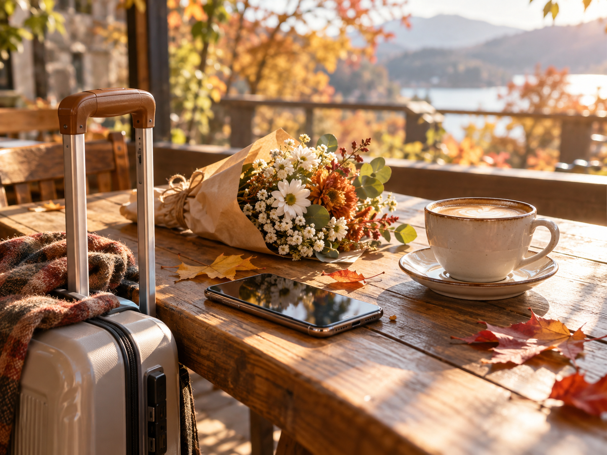
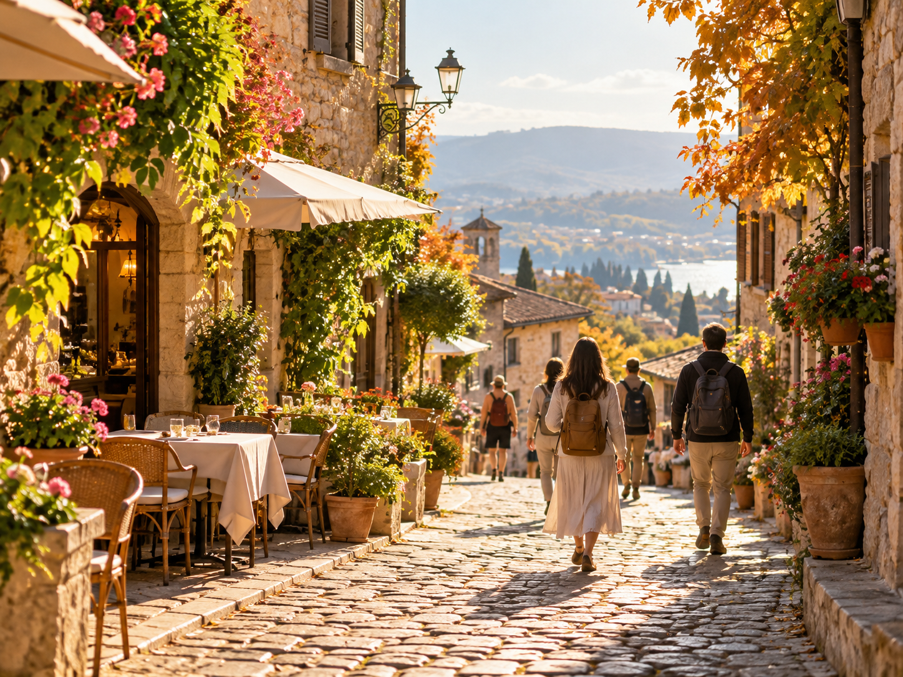
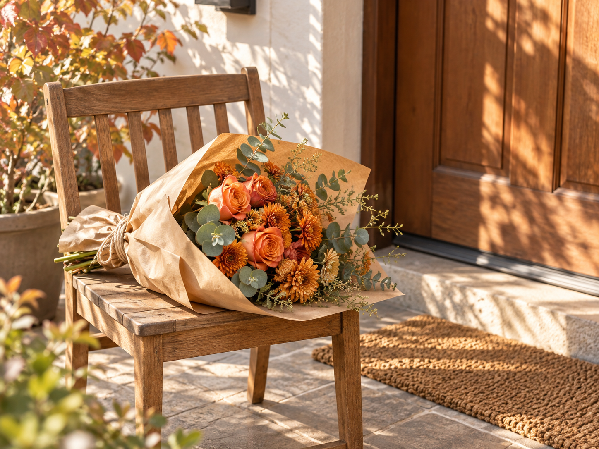
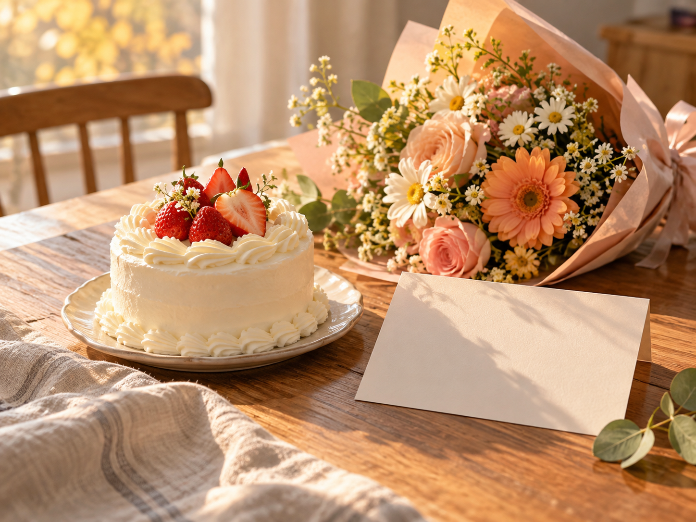
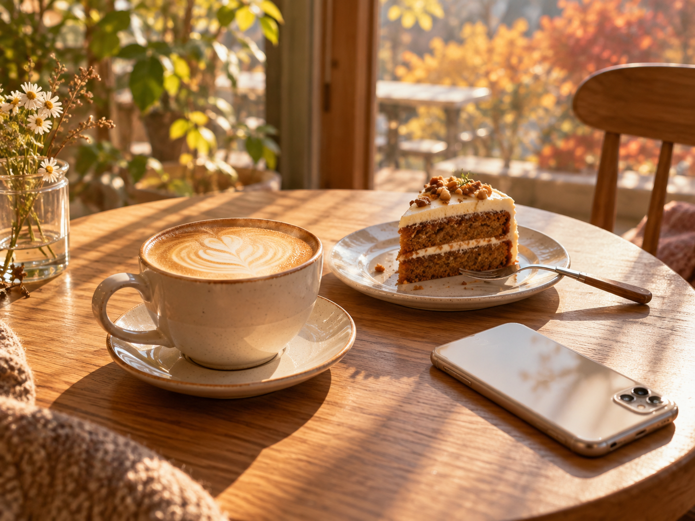
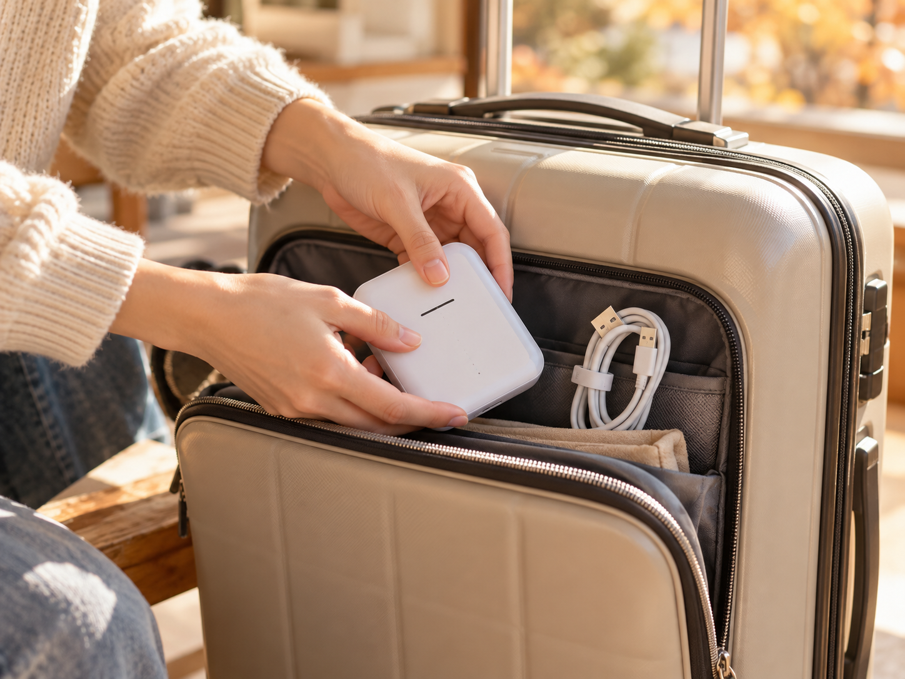
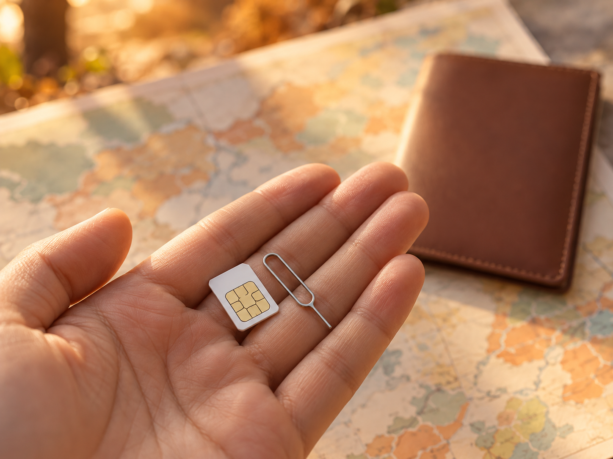
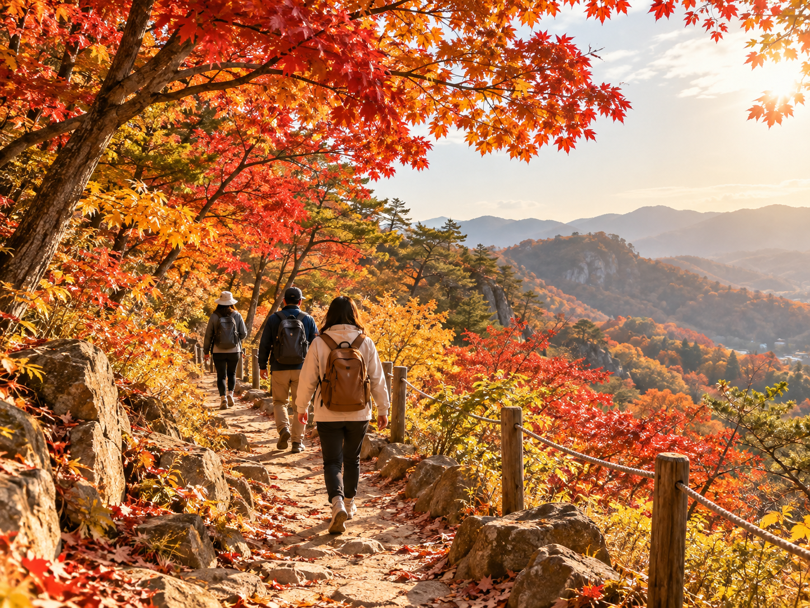
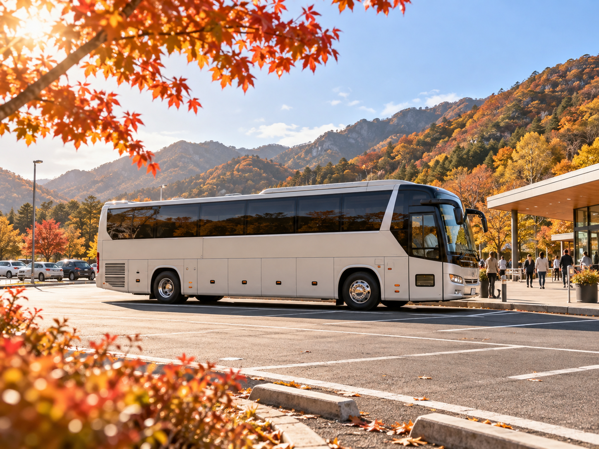
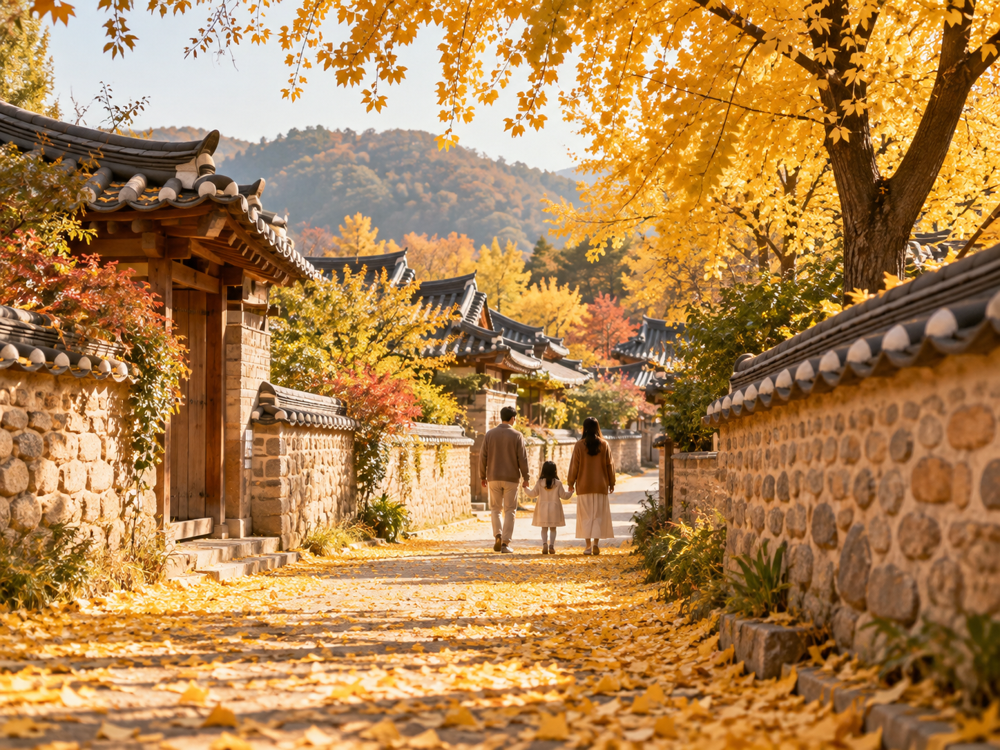

# 요즘 사람들은 뭘 찾을까? 네이버 데이터랩 여가/생활편의 인기분야 TOP5 (10월 18일 기준)

안녕하세요 😊
아침저녁으로 제법 쌀쌀해진 10월이에요. 요즘 다들 뭘 많이 찾아보는지 궁금해서, 네이버 데이터랩의 '여가/생활편의' 인기분야 순위를 들여다봤어요.

참고로 이 순위는 개별 검색어가 아니라 쇼핑 '분야'의 순위예요. 몇 명이 찾았는지 같은 숫자는 나오지 않아서, 오늘은 어떤 분야가 위에 있는지와 그 배경을 가볍게 짚어 볼게요. 준비하면서 알아 두면 좋은 작은 팁도 함께 적어 두었어요.

## 1위 · 해외패키지/기타 ✈️

10월 18일 기준 1위는 해외 패키지여행이었어요. 올해 10월은 개천절, 한글날에 연차를 붙여 여행 계획을 세우는 분들이 많았죠.

연휴는 지났지만, 다음 휴가나 연말 여행을 미리 알아보는 분들도 많은 것 같아요. 패키지는 항공, 숙소, 일정이 한 번에 묶여 있어서 준비할 게 적다는 점이 가장 큰 장점이에요.

💡 고를 때는 포함 내역(식사, 가이드비, 선택 관광)과 쇼핑 일정 횟수를 꼭 비교해 보세요. 같은 여행지라도 출발 요일이나 항공 시간에 따라 가격 차이가 꽤 나요. 일정표에 '자유 시간'이 얼마나 있는지도 함께 보면, 나에게 맞는 여행인지 가늠하기 쉬워요.

## 2위 · 꽃/케이크배달 💐

2위는 꽃과 케이크 배달이에요. 바로 전날인 17일에는 3위였는데 한 계단 올라왔어요. 생일이나 기념일에 직접 찾아가기 어려울 때 마음을 전하기 좋죠.

꽃다발에 작은 케이크를 함께 보내는 구성도 많더라고요. 받는 날짜와 시간을 꼭 지정하고, 배송 가능 지역도 미리 확인하는 게 좋아요. 꽃은 계절마다 들어오는 종류가 달라서, 사진과 똑같은 꽃이 아닐 수 있다는 안내도 한 번 읽어 두면 받았을 때 서운하지 않아요. 짧은 손글씨 카드를 함께 넣으면 마음이 더 잘 전해져요.

## 3위 · e쿠폰 🎁

3위는 e쿠폰, 흔히 말하는 모바일 상품권이에요. 커피나 케이크 교환권처럼 메시지로 바로 보낼 수 있어서 부담 없는 선물로 자주 쓰여요.

받은 쿠폰은 유효기간을 꼭 확인하세요! 휴대폰 앨범에 저장해 두면 잊지 않고 쓸 수 있어요. 보내는 입장에서는 받는 분이 자주 가는 매장인지 먼저 떠올려 보면 좋아요. 금액형 쿠폰은 차액을 다음에 쓸 수 있는지도 매장마다 달라서 미리 알아 두면 편해요.

## 4위 · 와이파이/USIM 📶

4위는 여행지에서 쓰는 와이파이 도시락과 유심이에요. 해외여행을 준비할 때 빠질 수 없는 항목이죠.

요즘은 유심을 갈아 끼우지 않고 설정만으로 쓰는 eSIM도 많이 나와 있어요. 내 휴대폰이 지원하는지, 여행 기간과 데이터 양에 맞는지 먼저 확인하면 실패가 없어요. 여러 명이 함께 간다면 와이파이 도시락 하나를 나눠 쓰는 것도 방법이에요. 대신 일행과 떨어지면 연결이 끊기니, 각자 움직일 일정이 많다면 유심이나 eSIM이 더 편할 수 있어요.

## 5위 · 국내패키지/기타 🍁

5위는 국내 패키지여행이에요. 단풍이 물드는 계절이라 가까운 곳으로 가을 여행을 떠나기 딱 좋죠. 운전 걱정 없이 버스로 이동하고, 식사와 입장권까지 한 번에 해결되는 당일치기 상품은 부모님과 함께 가기에도 좋아요.

문화체육관광부가 10~11월에 '2026 여행가는 가을' 캠페인으로 교통, 숙박 혜택을 안내하고 있어요. 혜택마다 기간과 조건이 다르니 공식 안내를 꼭 확인해 보세요.

국내 패키지를 고를 때는 집결 장소와 출발 시간을 먼저 확인해 보세요. 이른 아침 출발이 많아서, 집에서 가까운 곳에서 타는 상품이 훨씬 편하답니다. 걷는 구간이 긴지, 자유 시간이 넉넉한지도 미리 보면 일행 모두가 즐거운 여행이 될 거예요. 산이나 바닷가는 낮과 밤의 기온 차가 크니 얇은 겉옷도 하나 챙기세요.

## 마무리하며 ☕

이번 순위를 보면 여행 준비(해외·국내 패키지, 와이파이/유심)와 마음을 전하는 선물(꽃·케이크 배달, e쿠폰)이 위쪽에 함께 올라와 있었어요. 순위가 오른 이유를 하나로 단정할 수는 없지만, 가을 여행과 선물 고민이 많은 시기인 건 분명해 보여요.

여러분은 요즘 어떤 걸 가장 많이 찾아보셨나요? 댓글로 알려 주세요 😊

---
출처: 네이버 데이터랩 쇼핑인사이트 '인기분야 · 여가/생활편의 · 일간'(2026.10.18. 기준) · 문화체육관광부 2026-09-15 보도자료 「2026 여행가는 가을」

---

## 네이버 블로그에 올리는 법(와이프분용)
1. 이 PR의 `images` 폴더에서 img01 ~ img15 를 내려받습니다(파일을 누르고 오른쪽 위 내려받기 단추).
2. 네이버 블로그 글쓰기에서 제목에 맨 위 제목을 넣습니다.
3. 본문을 위에서부터 복사해 붙이고, 그림이 있던 자리마다 같은 번호 그림(img01, img02 …)을 사진 올리기로 넣습니다.
4. `## 1위 · …` 같은 줄은 소제목(인용구나 굵은 글씨)으로 바꿔 주세요. 맨 아래 출처 줄은 그대로 둡니다.
